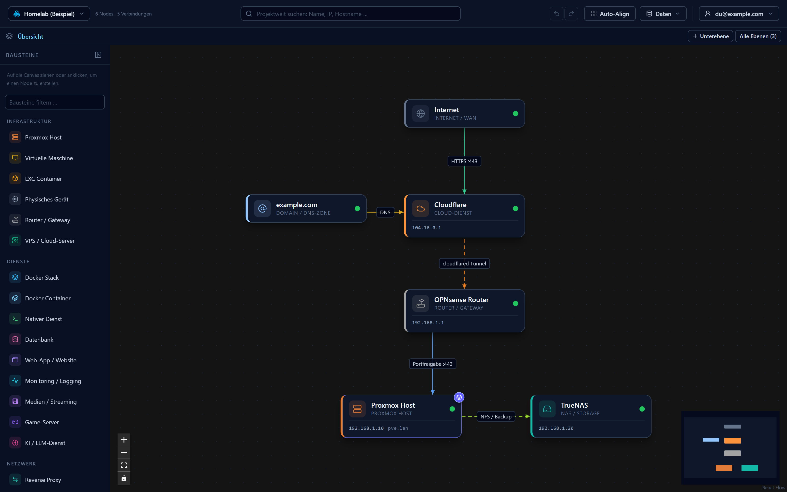
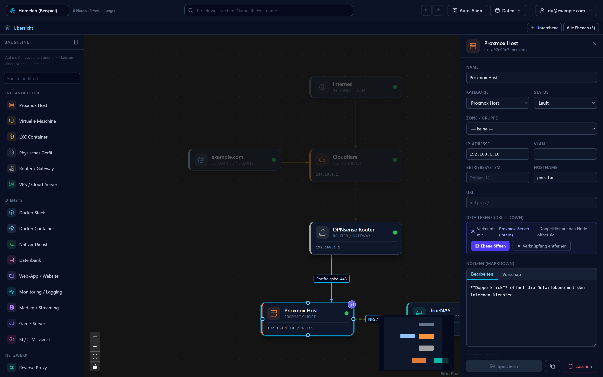

# 🕸️ Lab Visualizer

A self-hosted **infrastructure documentation tool**. Map systems, services and
their dependencies on an interactive canvas — from homelabs and cloud setups to
software and process landscapes. Multi-user, offline-capable, MIT-licensed.




## Quick start

```bash
docker compose up -d --build
```

Web UI: **http://localhost:8080** · API: **http://localhost:8080/api**

Register an account on first visit. Every new account gets a three-level example
project (*Internet → Cloudflare → router → virtualization host → NAS*) so there
is something to explore instead of a blank canvas.

Pre-built images from GHCR instead of a local build:

```bash
export BACKEND_VERSION=$(tr -d '[:space:]' < backend/VERSION)
export FRONTEND_VERSION=$(tr -d '[:space:]' < frontend/VERSION)
docker compose pull && docker compose up -d
```

> ⚠️ **Running it publicly?** Serve over **HTTPS** and set `COOKIE_SECURE=true`,
> otherwise session cookies travel unencrypted.

The SQLite database lives in `./data/labviz.db` — back up by copying the whole
`data/` folder (WAL mode), or `sqlite3 data/labviz.db ".backup backup.db"`.

## Features

- **Levels (drill-down)** — a node on the overview links to its own detail
  level; double-click zooms in, like the C4 model. Navigate by breadcrumb.
- **Visual editor** — drag nodes from the palette, connect them, group them in
  zones. Edges dock to the best side and route around obstacles; double-click a
  line to add a waypoint. Snap lines while dragging, undo/redo throughout.
- **Deep-dive panel** — typed fields from the catalog, grouped by topic, plus
  Markdown notes with live preview and free-form key/value custom fields.
- **Domain packs** — each project only sees the categories, fields and edge
  kinds of its domain. A process project gets *process step, role, cost center*
  instead of *hypervisor, VLAN, IP address*. Switchable at any time without data
  loss.
- **Projects with templates** — separate workspaces, each started from a
  template: homelab, network plan, cloud, Kubernetes, software architecture,
  process & organization — or empty.
- **Search & filters** — global search across all levels of a project jumps to
  the right level and centers the hit. Filters work on status, category and
  every select field; non-matching nodes are dimmed, not hidden.
- **Custom icons & images** — give any node its own image (PNG, JPEG, WebP,
  SVG), or embed images in notes. They stay on your instance and travel with the
  project export.
- **Read-only share links** — share a project at `…/s/<token>` without the
  viewer needing an account. Optional expiry, revocable at any time; only the
  token hash is stored.
- **Export as image or JSON** — save the current level as PNG or SVG, back up
  everything as JSON, or export a single project and merge-import it elsewhere.
- **Accounts** — email/password, scrypt hashes, server-side sessions. Each
  person sees only their own projects. See [Security](#security).
- **API-first & MCP** - every UI action goes through the REST API (OpenAPI 3.1,
  docs at `/docs`). API keys with read/write scope, plus a built-in MCP server
  so AI agents can read and document your infrastructure.

<details>
<summary><b>Deep-dive panel</b> — typed fields, Markdown notes, focus mode</summary>



</details>

## Architecture

```
┌───────────────┐     /api (proxy)      ┌────────────────┐        ┌─────────────┐
│   Frontend    │ ────────────────────▶ │    Backend     │ ─────▶ │   SQLite    │
│ React + Vite  │                       │ Express (Node) │        │ ./data/*.db │
│ React Flow    │                       │  REST API+Zod  │        └─────────────┘
│ nginx (:8080) │                       │     (:3000)    │
└───────────────┘                       └────────────────┘
```

- **Frontend** — React 18 + TypeScript, React Flow, Zustand, Tailwind CSS 4.
  Served by nginx, which proxies `/api` to the backend.
- **Backend** — Node.js 22 + Express, better-sqlite3, Zod validation. No ORM.
- **Catalog-driven** — categories, statuses, edge kinds *and* field definitions
  live in `backend/src/catalog/`. A new field is one entry there: panel, canvas,
  search and validation all follow. No DB migration, no UI change.
- **Product-neutral** — the catalog describes building blocks (hypervisor,
  container, database), not vendors. "Proxmox VE", "AWS" or "SAP" are *values*
  in the `platform` field.

```
backend/src/     server.js · app.js · auth.js · db.js · store.js (all business logic)
                 apiKeys.js · openapi.js · mcp/ · catalog/ · templates/ · routes/
frontend/src/    store/graph.ts (canvas ⇄ API) · components/{canvas,panel,views,share}
                 lib/catalog.ts · lib/icons.tsx · lib/diagramImage.ts
```

## API & MCP

Create an API key in the account menu (*API keys & MCP*) and send it as
`Authorization: Bearer lvk_…`. Keys are `read` or `write` and never touch
account settings.

- **Docs:** `/docs` on your instance, rendered from `/api/openapi.json`
- **MCP:** `/api/mcp` for Claude, Cursor, VS Code and other MCP clients
- **Agent reference:** [AGENTS.md](AGENTS.md)

```bash
curl -H "Authorization: Bearer $LABVIZ_API_KEY" http://localhost:8080/api/projects

claude mcp add --transport http lab-visualizer http://localhost:8080/api/mcp \
  --header "Authorization: Bearer $LABVIZ_API_KEY"
```

## Configuration

Set values in a `.env` file (template: [`.env.example`](.env.example)); it is
neither committed nor deployed.

| Variable | Default | Description |
|---|---|---|
| `PORT` | `3000` | Backend port |
| `DATA_DIR` | `/data` (container) | Where the SQLite DB lives |
| `COOKIE_SECURE` | auto | Forces the `Secure` cookie flag. On in production. |
| `SESSION_TTL_DAYS` | `30` | Session lifetime (sliding renewal) |
| `ALLOW_REGISTRATION` | `true` | `false` disables self-registration |
| `CORS_ORIGIN` | _(empty)_ | Comma-separated cross-origins allowed with credentials |
| `MAX_PROJECTS_PER_USER` | _(unlimited)_ | See [Instance limits](#instance-limits) |
| `MAX_VIEWS_PER_PROJECT` | _(unlimited)_ | Levels per project |
| `MAX_NODES_PER_PROJECT` | _(unlimited)_ | Nodes per project |
| `MAX_ASSETS_PER_USER` | _(unlimited)_ | Uploaded images per account |
| `MAX_ASSET_BYTES` | `1048576` | Largest image upload |
| `RATE_LIMIT_WRITES_PER_MIN` | `600` | Write requests per minute and IP (`0` = off) |
| `MAX_BODY` / `MAX_IMPORT_BODY` | `2mb` / `20mb` | Request body size |
| `LEGAL_DIR` | `$DATA_DIR/legal` | Directory holding the legal texts |
| `DEBUG_LOG` | `false` | `true` logs `[Debug …]` lines (API keys, MCP calls) |

### Behind a reverse proxy / Cloudflare

- nginx ships the security headers (CSP with no external sources, HSTS,
  `X-Frame-Options: DENY`, `nosniff`, referrer and permissions policy) and
  forwards `CF-Connecting-IP`, so rate limiting applies per real client.
- CSRF is covered by `SameSite=Lax` plus an `Origin` check; CORS is off because
  frontend and API are same-origin through the proxy.
- The frontend only starts once the backend passes its health check.
- Recommended in Cloudflare: "Always Use HTTPS", HSTS, and keep the origin
  reachable through the tunnel only.

### Instance limits

Lab Visualizer is free and has nothing to buy — **by default no limit applies**.
If you run a public instance, the variables above cap what a single account can
use. Limits are enforced server-side (`backend/src/limits.js`), imports are
checked before anything is written, and exceeding one returns `403` with
`code: "limit_reached"`. If the limits are too tight for the example project
every new account gets, the backend refuses to start with a clear message
instead of failing every registration later.

### Legal texts

Running a public instance may require a legal notice and a privacy policy. They
are not part of the source — otherwise every fork would serve someone else's
address. Each instance drops its own files into the data volume:

```
data/legal/legal-notice.md
data/legal/privacy.md
```

Fill-in templates with notes are in [`docs/legal/`](docs/legal). Existing files
are linked automatically from the sign-in screen and the account menu, and served
by `GET /api/meta/legal`. Missing files simply hide the link. (The old German
names `impressum.md` / `datenschutz.md` still work.)

## Security

- **Passwords** hashed with scrypt (`node:crypto`) and a per-user salt,
  verified in constant time.
- **Sessions** live server-side in SQLite; the cookie holds only a 256-bit
  random token, the database only its SHA-256 hash. `HttpOnly`, `SameSite=Lax`,
  `Secure` over HTTPS. Logout ends the session immediately.
- **API keys** - 256-bit, only the SHA-256 hash is stored, shown once. A `read`
  key cannot write; no key can change the password, delete the account or
  create further keys.
- **Data isolation** — every project belongs to a user; levels, nodes and edges
  inherit ownership, and every access is checked.
- **Brute force** — login and registration are rate-limited per IP with generic
  error messages; writes are throttled separately.
- **Offline** — no external CDNs, fonts or trackers.

Report vulnerabilities privately, not as a public issue — see
[SECURITY.md](SECURITY.md).

## Development

```bash
cd backend && npm install && npm run dev     # API on :3000
```

```bash
cd frontend && npm install && npm run dev    # Vite on :5173, proxies /api
```

Before a pull request, run what CI runs:

```bash
cd backend && npm test
```

```bash
cd frontend && npm test && npm run build
```

Details, release process and review criteria: [CONTRIBUTING.md](CONTRIBUTING.md).

## License

[MIT](LICENSE) — use, modify and run it freely, commercially or privately. The
only condition is keeping the copyright notice.
